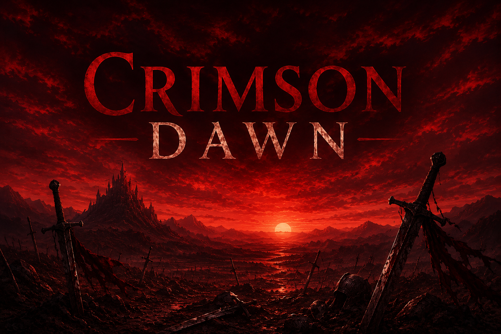

<p align="center"></p>

<h1 align="center">Dawn Launcher</h1>

<p align="center">
<a href="https://github.com/VoidKen/DawnLauncher/releases"></a>
<a href="https://github.com/VoidKen/DawnLauncher/releases/latest"></a>
<a href="https://discord.gg/43GmU3kMt"></a>
</p>

<p align="center">Build your own modded Minecraft packs, play them with one click, and share them with friends using a short code. Java, Forge, Fabric and NeoForge are handled for you.</p>

## Features

* 🧱 **Build your own modpacks.**
  * Pick a Minecraft version and a loader (Fabric, Forge or NeoForge), search for mods, and press **Create Pack**.
  * Browse **Modrinth** and **CurseForge** together, or filter to one of them. Search for mods or whole modpacks.
  * Required dependencies are added for you.
* 📦 **Import existing packs.**
  * Drag in a Modrinth pack (`.mrpack`), a CurseForge pack (`.zip`), or a plain `.zip` of mod `.jar` files.
  * Config files that come with a pack are copied over automatically.
* 🔗 **Share with a code.** Turn any pack into a short code like `ABCD-EFGH`. A friend enters it and gets exactly the same pack.
* 🔒 **Full account management.**
  * Add multiple accounts and easily switch between them.
  * Microsoft (OAuth 2.0) authentication supported.
  * Credentials are never stored by the launcher and are sent directly to Microsoft/Mojang.
* ☕ **Automatic Java validation.** If you have an incompatible version of Java installed, the launcher installs the right one for you.
* 📂 Files are validated before launch. Corrupt or missing files are downloaded again.
* 📰 News feed built into the launcher (shows the latest releases).
* ⚙️ Settings, including a Java control panel.
* 🔄 Automatic updates. The launcher updates itself from GitHub releases.

## Downloads

Get the latest installer from [GitHub Releases](https://github.com/VoidKen/DawnLauncher/releases).

| Platform | File |
| -------- | ---- |
| Windows x64 | `Dawn-Launcher-setup-VERSION.exe` |

Windows may show a "Windows protected your PC" warning because the installer is not code signed yet. Choose **More info**, then **Run anyway**.

## Using it

1. Open **Mod Packs** on the main screen.
2. **Build a Pack**: choose a version and loader, add mods, and create the pack. Or use **Enter a Code** to load a friend's pack, or **Import** to bring in a pack file.
3. Under **My Packs**, press **Use** on a pack, close the window, and press **Launch**.

Packs made from mods on your own computer (a zip of `.jar` files) cannot be shared by code, because the files only exist on your machine.

## Console

To open the console, use the following keybind.

```console
ctrl + shift + i
```

Make sure the console tab is selected. Do not paste anything into the console unless you are 100% sure of what it will do. Pasting the wrong thing can expose sensitive information.

## Development

### Getting Started

**System requirements**

* [Node.js][nodejs] v22

**Clone and install dependencies**

```console
> git clone https://github.com/VoidKen/DawnLauncher.git
> cd DawnLauncher
> npm install
```

**Run the launcher**

```console
> npm start
```

**Build installers**

```console
> npm run dist:win
```

Builds for other platforms (`npm run dist:mac`, `npm run dist:linux`) are possible but only Windows is tested.

### CurseForge API key

CurseForge search and imports need a CurseForge API key from [console.curseforge.com](https://console.curseforge.com/).

For a build that includes the key, copy `app/assets/js/packs/curseforge-key.example.json` to `app/assets/js/packs/curseforge-key.json` and put your key in it. This file is ignored by git, so it never goes into the repository. Anyone can extract the key from an installed app, so keep that in mind.

Without a bundled key, a player can save their own key in a file named `curseforge-api-key.txt` in the launcher's data folder. Modrinth works without any key.

### Share codes

Share codes are stored in a Supabase table named `packs`. The project URL and publishable key are in `app/assets/js/packs/packstore.js`. A GitHub Action (`.github/workflows/supabase-keepalive.yml`) pings it regularly so the free project is not paused.

### Releases and auto update

Releases are published with electron-builder to GitHub Releases. The publisher needs a `GH_TOKEN` with write access to the repository's contents.

### Visual Studio Code

Paste the following into `.vscode/launch.json`:

```JSON
{
  "version": "0.2.0",
  "configurations": [
    {
      "name": "Debug Main Process",
      "type": "node",
      "request": "launch",
      "cwd": "${workspaceFolder}",
      "program": "${workspaceFolder}/node_modules/electron/cli.js",
      "args" : ["."],
      "outputCapture": "std"
    },
    {
      "name": "Debug Renderer Process",
      "type": "chrome",
      "request": "launch",
      "runtimeExecutable": "${workspaceFolder}/node_modules/.bin/electron",
      "windows": {
        "runtimeExecutable": "${workspaceFolder}/node_modules/.bin/electron.cmd"
      },
      "runtimeArgs": [
        "${workspaceFolder}/.",
        "--remote-debugging-port=9222"
      ],
      "webRoot": "${workspaceFolder}"
    }
  ]
}
```

This adds two debug configurations: one for Electron's [main process][mainprocess] and one for the [renderer process][rendererprocess]. The renderer configuration needs the [Debugger for Chrome][chromedebugger] extension, and you cannot open the DevTools window while using it.

## Credits

Dawn Launcher is built on [Helios Launcher](https://github.com/dscalzi/HeliosLauncher) by Daniel Scalzi, and uses [helios-core](https://github.com/dscalzi/helios-core). Mod and modpack data comes from [Modrinth](https://modrinth.com/) and [CurseForge](https://www.curseforge.com/). Thank you to all of them.

For instructions on setting up Microsoft authentication for your own copy, see the [original guide](https://github.com/dscalzi/HeliosLauncher/blob/master/docs/MicrosoftAuth.md).

## Contact

Join the [Discord][discord] for help or to share packs.

### See you ingame.

[nodejs]: https://nodejs.org/en/ 'Node.js'
[mainprocess]: https://electronjs.org/docs/tutorial/application-architecture#main-and-renderer-processes 'Main Process'
[rendererprocess]: https://electronjs.org/docs/tutorial/application-architecture#main-and-renderer-processes 'Renderer Process'
[chromedebugger]: https://marketplace.visualstudio.com/items?itemName=msjsdiag.debugger-for-chrome 'Debugger for Chrome'
[discord]: https://discord.gg/F7QPRcPH6z 'Discord'
